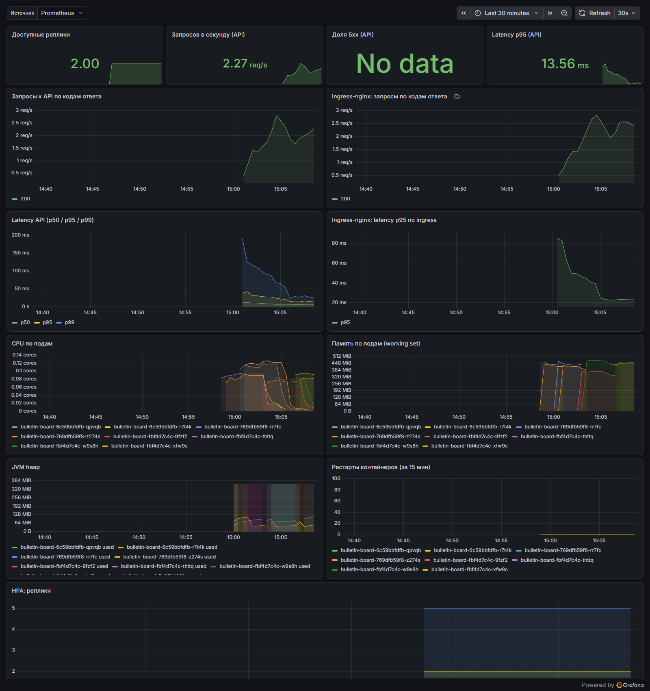

# Доска объявлений (Kubernetes)

[](https://github.com/kicha3007-boop/kubernetes-project-319/actions/workflows/hexlet-check.yml)
[](https://github.com/kicha3007-boop/kubernetes-project-319/actions/workflows/ci.yml)

Учебный проект Хекслета: https://ru.hexlet.io/programs/kubernetes ·
Как это должно работать: https://asciinema.org/a/v4evn7XjCdou7Yh71IG0ljb0W

Приложение «Доска объявлений» (Spring Boot + React Admin) упаковано в образ и разворачивается
в Kubernetes Helm-чартом. Инфраструктура Yandex Cloud (VPC, Managed Kubernetes, Managed PostgreSQL,
Object Storage, Lockbox, Cloud Logging) описана в Terraform, секреты приходят из Lockbox через
External Secrets Operator, метрики собирает Prometheus, алерты и дашборд входят в чарт.

> **Честно о стенде.** Облачного аккаунта у автора нет, поэтому в Yandex Cloud ничего не
> разворачивалось: ссылки на работающее облачное приложение нет. Terraform-код полный и проходит
> `terraform fmt -check`, `terraform validate` и `tflint`, но `plan/apply` не выполнялись.
> Всё, что относится к Kubernetes, **реально проверено на локальном кластере kind**: чарт,
> ingress, HPA/PDB, rolling update без 5xx, `helm rollback`, синхронизация и ротация секретов
> через ESO, Prometheus/Grafana/алерты. Выводы команд — в [docs/evidence](docs/evidence),
> скриншоты — в [docs/screenshots](docs/screenshots).
>
> Локальный адрес приложения после `make local-up`: <http://bulletin-board.localhost:18080>

## Содержание

- [Архитектура](#архитектура)
- [Структура репозитория](#структура-репозитория)
- [Требования к машине](#требования-к-машине)
- [Быстрый старт: локально в kind](#быстрый-старт-локально-в-kind)
- [Развёртывание в Yandex Cloud](#развёртывание-в-yandex-cloud)
- [Образ и реестр](#образ-и-реестр)
- [Helm: окружения, релизы, откаты](#helm-окружения-релизы-откаты)
- [Масштабирование и zero-downtime](#масштабирование-и-zero-downtime)
- [Секреты: Lockbox + External Secrets](#секреты-lockbox--external-secrets)
- [Мониторинг и логи](#мониторинг-и-логи)
- [CI](#ci)
- [Команды Makefile](#команды-makefile)
- [Приложение и изменения в нём](#приложение-и-изменения-в-нём)

## Архитектура

```text
Yandex Cloud (terraform/)
  VPC bulletin-board-net: 3 подсети + NAT-шлюз + группы безопасности
  │
  ├── Managed Kubernetes (мастер с публичным API, KMS-шифрование секретов)
  │     └── Node group: 2 ноды без публичных IP (выход через NAT)
  │           ├── ingress-nginx  ── Service LoadBalancer ──> публичный IP
  │           ├── bulletin-board (Helm): Deployment 2..6 подов, HPA, PDB
  │           ├── External Secrets Operator ──> Lockbox
  │           ├── Reloader (перезапуск подов при ротации)
  │           ├── Prometheus ── remote_write ──> Managed Service for Prometheus
  │           └── Fluent Bit ──> Cloud Logging (retention 72h)
  ├── Managed PostgreSQL 16 (доступ только из подсетей кластера)
  ├── Object Storage: бакет картинок + статический ключ SA
  └── Lockbox: пароль БД, JDBC URL, ключи S3

Локально (k8s/kind/): kind 1 control-plane + 2 worker, ingress-nginx на 127.0.0.1:18080,
PostgreSQL в кластере, «эмулятор Lockbox» (Secret в отдельном namespace) для ESO,
kube-prometheus-stack (Prometheus, Alertmanager, Grafana).
```

## Структура репозитория

```text
.
├── app/                         # код приложения (перенесён из Hexlet-components/project-devops-deploy)
├── Dockerfile                   # многоступенчатая сборка: Vite -> Gradle -> JRE
├── docker-compose.yaml          # образ + PostgreSQL без Kubernetes (prod-профиль)
├── Makefile                     # все команды: образ, terraform, kind, k8s, helm, секреты, мониторинг
├── terraform/                   # Yandex Cloud: сеть, кластер, нод-группа, БД, бакет, Lockbox, IAM, логи
├── k8s/
│   ├── manifests/               # чистые манифесты (шаги 3–4): namespace, configmap, secret, deployment,
│   │                            #   service, ingress, pdb, hpa
│   ├── bulletin-board/          # Helm-чарт: Chart.yaml, values*.yaml, templates/, files/dashboard.json
│   ├── addons/                  # values сторонних чартов: ingress-nginx, metrics-server, ESO, Reloader,
│   │                            #   kube-prometheus-stack, Fluent Bit (kind и YC)
│   ├── local/postgres.yaml      # PostgreSQL для kind
│   └── kind/cluster.yaml        # конфигурация локального кластера
├── scripts/                     # probe (проверка без простоя), ротация, bootstrap state, мониторинг YC
├── docs/                        # подробности: rollout, секреты, мониторинг, облако; evidence и скриншоты
└── .github/workflows/           # hexlet-check (не трогать) и ci
```

## Требования к машине

Общие:

| Инструмент | Версия (проверено) | Зачем |
| --- | --- | --- |
| Docker (Desktop) | 28.x, ≥ 6 ГБ RAM для Docker | образ, kind |
| GNU Make, bash | любые (на Windows — Git Bash) | Makefile и скрипты |
| kubectl | 1.37 | работа с кластером |
| Helm | 3.16+ или 4.x (проверено на 4.3.1) | чарты |
| kind | 0.33 | локальный кластер |
| Terraform | ≥ 1.6 (проверено на 1.17.0) | инфраструктура |
| curl, jq | любые | проверки и скрипты |

Для облака дополнительно:

- [Yandex Cloud CLI](https://yandex.cloud/ru/docs/cli/quickstart#install) (`yc init`), каталог и права
  `admin` на него (или `editor` + `resource-manager.admin` для назначения ролей);
- аутентификация Terraform: `export YC_TOKEN=$(yc iam create-token)` или ключ сервисного аккаунта
  `export YC_SERVICE_ACCOUNT_KEY_FILE=key.json`;
- доступ к реестру образов: GHCR (PAT со scope `write:packages`) — см. [Образ и реестр](#образ-и-реестр).

Если `registry.terraform.io` недоступен, Terraform ставит провайдер через зеркало Яндекса —
файл `~/.terraformrc` (или путь в `TF_CLI_CONFIG_FILE`):

```hcl
provider_installation {
  network_mirror {
    url     = "https://terraform-mirror.yandexcloud.net/"
    include = ["registry.terraform.io/*/*"]
  }
  direct {
    exclude = ["registry.terraform.io/*/*"]
  }
}
```

Ресурсы для локального стенда: kind (3 ноды) + приложение (2 пода) + PostgreSQL + ingress-nginx +
ESO + Reloader + kube-prometheus-stack занимают около **4–4.5 ГБ RAM** и 4 CPU. Без мониторинга —
около 2.5 ГБ.

## Быстрый старт: локально в kind

Одной командой (сборка образа, кластер, аддоны, БД, секреты, мониторинг, релиз):

```bash
make local-up
```

Проверено: кластер с нуля (инструменты уже установлены) — ~12 минут, `exit 0` — [docs/evidence/00-make-local-up.txt](docs/evidence/00-make-local-up.txt).

То же по шагам:

```bash
make kind-up                 # кластер p319: 1 control-plane + 2 worker, порты 18080/18443 на 127.0.0.1
make addons                  # ingress-nginx, metrics-server, External Secrets Operator, Reloader
make build kind-load         # образ ghcr.io/kicha3007-boop/bulletin-board:1.1.0 -> в ноды kind
make db-local                # PostgreSQL в namespace bulletin-db
make eso-seed                # «эмулятор Lockbox»: Secret lockbox-emulator/bulletin-board-app
make monitoring-install      # kube-prometheus-stack + метрики ingress-nginx
make helm-install ENV=local  # релиз bulletin-board; ждёт rollout status
```

Проверка:

```bash
curl http://bulletin-board.localhost:18080/api/bulletins?perPage=1   # API через ingress
open http://bulletin-board.localhost:18080/                          # UI (React Admin)
make k8s-status                                                      # поды, HPA, PDB, ingress
make helm-test                                                       # helm test изнутри кластера
make grafana-password  # Grafana: http://grafana.localhost:18080 (admin / этот пароль)
                       # Prometheus: http://prometheus.localhost:18080, Alertmanager: http://alertmanager.localhost:18080
```

Имена `*.localhost` браузеры и curl резолвят в 127.0.0.1 сами. Если нет — добавьте их в hosts
или используйте `curl -H "Host: bulletin-board.localhost" http://127.0.0.1:18080/...`.

Базовый вариант без Helm (шаг 3) — чистые манифесты из `k8s/manifests`:

```bash
make k8s-apply   # postgres + namespace, ConfigMap, Secret, Deployment, Service, Ingress, PDB, HPA
kubectl -n bulletin-board port-forward svc/bulletin-board 18085:80   # временный доступ
make k8s-delete  # перед установкой Helm-релиза в тот же namespace
```

Удалить всё: `make local-down`.

> На Windows с системным прокси kind пробрасывает переменные `HTTP(S)_PROXY` в ноды, и образы
> перестают скачиваться (`proxyconnect 127.0.0.1:...`). Цель `kind-up` запускает kind без них.

## Развёртывание в Yandex Cloud

Подробно, с проверками на каждом шаге — [docs/yandex-cloud.md](docs/yandex-cloud.md). Кратко:

```bash
# 0. Аутентификация
yc init
export YC_TOKEN=$(yc iam create-token)
cp terraform/terraform.tfvars.example terraform/terraform.tfvars   # cloud_id, folder_id

# 1. State в Object Storage (один раз) -> terraform/backend.hcl
make tf-bootstrap

# 2. Инфраструктура
make tf-init tf-plan tf-apply
make tf-output                       # ID кластера, нод-группы, Lockbox, параметры БД и бакета

# 3. Доступ к кластеру и аддоны
make yc-kubeconfig
make addons-yc                       # ingress-nginx (LoadBalancer), ESO, Reloader
make yc-eso-auth                     # ключ SA ESO -> Secret yc-auth

# 4. Образ и релиз
make build push TAG=1.1.0            # после make image-login
kubectl -n ingress-nginx get svc ingress-nginx-controller    # EXTERNAL-IP балансировщика
# ID Lockbox и имя бакета Makefile берёт из terraform output сам
make helm-install ENV=yc TAG=1.1.0 INGRESS_HOST=bulletin-board.<EXTERNAL-IP>.nip.io

# 5. Мониторинг и логи
YC_PROMETHEUS_WORKSPACE_ID=<id> make monitoring-yc

# Удаление
make tf-destroy
```

Состояние Terraform хранится в бакете Object Storage (S3-бекенд с частичной конфигурацией:
`terraform init -backend-config=backend.hcl`), в git его нет.

## Образ и реестр

`Dockerfile` собирает фронтенд (Node 24, Vite), бэкенд (JDK 27, Gradle `bootJar`) и кладёт jar в
образ на `eclipse-temurin:27-jre-alpine`; процесс работает от непривилегированного пользователя.
Базовые образы берутся из `mirror.gcr.io` (зеркало Docker Hub без rate limit), для Docker Hub:
`--build-arg BASE_REGISTRY=docker.io/library`.

```bash
make build TAG=1.1.0                                  # docker build --no-cache
export GHCR_USER=kicha3007-boop GHCR_TOKEN=<PAT write:packages>
make image-login                                      # docker login ghcr.io
make push TAG=1.1.0                                   # docker push ghcr.io/kicha3007-boop/bulletin-board:1.1.0
```

В CI образ собирается на каждый push; публикуется в GHCR только при git-теге `v*`
(`GITHUB_TOKEN`, отдельные секреты не нужны). Чарт не принимает `image.tag=latest` — релиз всегда
идёт по конкретному тегу.

Без Kubernetes образ можно проверить с PostgreSQL: `make compose-up` → <http://localhost:18090/api/bulletins>.

## Helm: окружения, релизы, откаты

Чарт `k8s/bulletin-board` — Deployment, Service, ConfigMap, Secret (или ExternalSecret + SecretStore),
Ingress, HPA, PDB, ServiceMonitor, PrometheusRule, ConfigMap с дашбордом Grafana, `helm test`.

Значения переопределяются слоями (последний выигрывает):

1. `values.yaml` — значения по умолчанию, только плейсхолдеры секретов;
2. `values-local.yaml` (kind) или `values-yc.yaml` (Yandex Cloud) — `-f`;
3. `--set` — то, что известно только после `terraform apply` (ID Lockbox, имя бакета, хост) и тег образа.

```bash
make helm-install ENV=local TAG=1.0.1     # helm upgrade --install ... --wait + kubectl rollout status
make helm-history                         # список ревизий
make helm-rollback REVISION=1             # helm rollback + kubectl rollout status
make helm-template ENV=yc                 # посмотреть итоговые манифесты
```

Откат возвращает и шаблон пода, и ConfigMap прошлой ревизии; секреты не откатываются (их источник —
Lockbox). Проверка в kind: [docs/evidence/03-helm-rollback.txt](docs/evidence/03-helm-rollback.txt) —
откат 1.0.1 → 1.0.0 под нагрузкой, 420 запросов, все 200.

## Масштабирование и zero-downtime

- **Ноды**: `node_count = 2` в Terraform (шаг 2 — 1 нода, шаг 4 — `terraform apply -var node_count=2`);
  обновление нод по одной: `deploy_policy { max_unavailable = 0, max_expansion = 1 }`.
- **Deployment**: `RollingUpdate` с `maxSurge: 1`, `maxUnavailable: 0`, `minReadySeconds: 5`;
  `startupProbe`/`readinessProbe`/`livenessProbe` на actuator (`/actuator/health/readiness` становится UP
  только после старта контекста и инициализации данных в БД); `preStop: sleep 10` + graceful shutdown
  Spring — под успевает выйти из балансировки до остановки; реплики разнесены по нодам
  (`topologySpreadConstraints`).
- **HPA**: 2..5 реплик (в облаке 2..6) по CPU 70% от requests, окно стабилизации scale-up 60 с
  (старт JVM кратко грузит CPU).
- HPA проверен нагрузкой: 2 → 5 реплик за ~80 с ([docs/evidence/06-hpa.txt](docs/evidence/06-hpa.txt)).
- **PDB**: `minAvailable: 1` при минимуме 2 реплики — drain ноды не останавливает сервис и не блокируется
  (чарт откажется рендериться, если `minAvailable` ≥ числа реплик).

Проверка: [docs/rollout.md](docs/rollout.md) и
[docs/evidence/02-rolling-update.txt](docs/evidence/02-rolling-update.txt) — выкат 1.0.0 → 1.0.1,
`kubectl rollout status` успешен, опрос через ingress все 120 секунд: 411 запросов, все HTTP 200.

## Секреты: Lockbox + External Secrets

- Terraform создаёт секрет Lockbox с ключами `SPRING_DATASOURCE_URL`, `SPRING_DATASOURCE_USERNAME`,
  `SPRING_DATASOURCE_PASSWORD`, `STORAGE_S3_ACCESSKEY`, `STORAGE_S3_SECRETKEY` и сервисный аккаунт ESO
  с ролью `lockbox.payloadViewer` **только на этот секрет**.
- В кластере ESO по `SecretStore` (провайдер `yandexlockbox`, авторизованный ключ SA в Secret `yc-auth`)
  создаёт обычный Secret `bulletin-board-secrets`; Deployment подключает его через `envFrom`.
- Ротация: новая версия секрета в Lockbox → ESO обновляет Secret за `refreshInterval` (1m) →
  Reloader перезапускает Deployment RollingUpdate-ом → новые поды с новым значением, без простоя.
- В git нет ни одного реального секрета: в `values.yaml` — плейсхолдеры, в `k8s/manifests/secret.yaml`
  и `k8s/local/postgres.yaml` — заглушка `local-dev-only` для локального kind.

Локально вместо Lockbox — Secret в namespace `lockbox-emulator` и провайдер ESO `kubernetes`: поток тот же
(источник → ESO → Secret → Reloader). Ротация пароля БД проверена: `make rotate-local` меняет пароль в
PostgreSQL и в источнике, ESO и Reloader выкатывают его за ~1 минуту; опрос через ingress — 604 запроса,
все 200 ([docs/evidence/04-secret-rotation.txt](docs/evidence/04-secret-rotation.txt)).
Подробно, включая облачную процедуру `make yc-rotate`, — [docs/secrets.md](docs/secrets.md).

## Мониторинг и логи

- Метрики приложения: Micrometer `/actuator/prometheus` на порту 9090 (запросы, коды, гистограммы
  latency, JVM), ServiceMonitor в чарте. Плюс ingress-nginx, kube-state-metrics, cAdvisor, node-exporter.
- Алерты (`PrometheusRule` в чарте): приложение недоступно, доля 5xx приложения и ingress > 5%,
  p95 latency > 0.5 с, heap > 90%, рестарты подов, недоступные реплики, HPA упёрся в максимум.
- Дашборд Grafana «Доска объявлений» (ConfigMap в чарте): реплики, RPS, 5xx, latency p50/p95/p99
  (приложение и ingress), CPU/память по подам, JVM heap, рестарты, HPA.
- Облако: тот же Prometheus отправляет метрики `remote_write` в **Managed Service for Prometheus**,
  логи подов уходят в **Cloud Logging** через Fluent Bit (фильтр по namespace, без health-проб,
  retention 72h из Terraform).

Локально всё поднято и проверено (скриншоты ниже), облачная часть описана и сконфигурирована, но не
запускалась. Подробно — [docs/monitoring.md](docs/monitoring.md).



## CI

`.github/workflows/ci.yml` на каждый push:

- **terraform**: `fmt -check`, `init -backend=false`, `validate`, `tflint`;
- **kubernetes**: `helm lint` для всех окружений, `helm template` + `kubeconform -strict`
  (CRD ESO и prometheus-operator — по схемам CRDs-catalog), `kubeconform` для `k8s/manifests`;
- **image**: сборка Docker-образа (push в GHCR — только по тегу `v*`).

`hexlet-check.yml` — автопроверка Хекслета (`terraform init -backend=false`, `validate`, `fmt -check`,
`tflint`); её прогон локально в образе проверки зелёный.

## Команды Makefile

`make help` выводит все цели. Основные:

| Цель | Что делает |
| --- | --- |
| `build`, `image-login`, `push` | собрать образ без кеша, войти в GHCR, опубликовать |
| `compose-up` / `compose-down` | образ + PostgreSQL в docker compose |
| `tf-bootstrap` | бакет для state и ключ к нему (yc CLI) → `terraform/backend.hcl` |
| `tf-init`, `tf-plan`, `tf-apply`, `tf-destroy`, `tf-output` | жизненный цикл инфраструктуры |
| `tf-fmt`, `tf-validate` | проверки без облака |
| `kind-up` / `kind-down`, `kind-load` | локальный кластер, загрузка образа в него |
| `addons` / `addons-yc` | ingress-nginx, metrics-server, ESO, Reloader |
| `db-local`, `k8s-apply`, `k8s-status`, `k8s-delete` | чистые манифесты |
| `helm-lint`, `helm-template`, `helm-install`, `helm-rollback`, `helm-history`, `helm-test` | Helm |
| `rollout-status`, `probe` | `kubectl rollout status`, опрос с подсчётом кодов ответа |
| `eso-seed`, `eso-status`, `rotate-local` | секреты в kind |
| `yc-kubeconfig`, `yc-eso-auth`, `yc-rotate`, `monitoring-yc` | облачные шаги |
| `monitoring-install`, `grafana-password` | мониторинг в kind |
| `local-up` / `local-down` | весь локальный стенд одной командой |

## Приложение и изменения в нём

Код в `app/` перенесён из [Hexlet-components/project-devops-deploy](https://github.com/Hexlet-components/project-devops-deploy)
(коммит `32620fc`, лицензия — `app/LICENSE`). Upstream не принимает инфраструктурные изменения, поэтому
вместо GitHub-форка код скопирован в этот репозиторий. Не перенесены служебные файлы upstream
(`.github`, `mise.toml`, `hk.pkl`, commitlint, lychee).

Изменения относительно upstream:

1. `StorageConfig`: S3 включается только при непустых `STORAGE_S3_*` (`StringUtils.hasText`). В профиле
   `prod` эти переменные по умолчанию раскрываются в пустые строки, и без S3 приложение пыталось создать
   S3-клиент с пустым регионом. Теперь без бакета картинки хранятся локально в поде (локальный стенд),
   с бакетом — в Object Storage (облако).
2. `gradle-wrapper.properties`: `networkTimeout` 10 с → 60 с и 3 повтора — дистрибутив Gradle не успевал
   скачиваться при сборке образа.
3. `frontend/package.json`: `@mui/material` и `@mui/icons-material` возвращены с `^9` на `^7.3.11`
   (lock-файл пересобран). В upstream код фронтенда использовал MUI 9, а `react-admin` 5.14 — свою копию
   MUI 7; тема из одной версии ломала компоненты другой, и UI падал с
   `TypeError: Cannot read properties of undefined (reading 'length')`. Исправлено в образе `1.1.0`
   (образы `1.0.0`/`1.0.1` в логах проверок — с этой ошибкой в UI, API в них работал).

Запуск приложения без контейнеров и описание API — [app/README.md](app/README.md).

---

<details>
<summary>Автоматические тесты Хекслета</summary>

Тесты запускаются на каждый коммит. За запуск отвечает файл `.github/workflows/hexlet-check.yml` — не удаляйте и не переименовывайте ни его, ни репозиторий.

</details>

## О Хекслете

[Хекслет](https://ru.hexlet.io/) — школа программирования: авторские программы обучения с практикой, поддержкой наставников и реальными проектами, которые остаются в резюме. Этот репозиторий — один из таких проектов.
